<a href="https://tourricon.com/en"><picture><source media="(prefers-color-scheme: dark)" srcset="assets/hero-dark.svg"></picture></a>

I'm Zhantai, founder of **[Tourricon](https://tourricon.com/en)** and an AI product engineer. I turn ideas into live products in weeks: AI agents write the code, I own the product, the architecture and the result.

Prague · Bishkek &nbsp;·&nbsp; English, Russian, Czech

<a href="https://tourricon.com/en"><picture><source media="(prefers-color-scheme: dark)" srcset="assets/btn-open-dark.svg"></picture></a>
<a href="https://tourricon.com/en/investors"><picture><source media="(prefers-color-scheme: dark)" srcset="assets/btn-investors-dark.svg"></picture></a>
<a href="mailto:connect@tourricon.com"><picture><source media="(prefers-color-scheme: dark)" srcset="assets/btn-contact-dark.svg"></picture></a>

## What I'm building

<a href="https://tourricon.com/en"><picture><source media="(prefers-color-scheme: dark)" srcset="assets/project-tourricon-dark.svg"></picture></a>

<a href="https://fit-fresh.vercel.app"><picture><source media="(prefers-color-scheme: dark)" srcset="assets/project-fitfresh-dark.svg"></picture></a>
<picture><source media="(prefers-color-scheme: dark)" srcset="assets/project-jarvis-dark.svg"></picture>
<picture><source media="(prefers-color-scheme: dark)" srcset="assets/project-jpass-dark.svg"></picture>
<picture><source media="(prefers-color-scheme: dark)" srcset="assets/project-efirio-dark.svg"></picture>

## How I build

<picture><source media="(prefers-color-scheme: dark)" srcset="assets/pipeline-dark.svg"></picture>

<picture><source media="(prefers-color-scheme: dark)" srcset="assets/stat-weeks-dark.svg"></picture>
<picture><source media="(prefers-color-scheme: dark)" srcset="assets/stat-commits-dark.svg"></picture>
<picture><source media="(prefers-color-scheme: dark)" srcset="assets/stat-tests-dark.svg"></picture>
<picture><source media="(prefers-color-scheme: dark)" srcset="assets/stat-ai-dark.svg"></picture>

Tourricon's codebase in November 2026. The code is private; I'm glad to walk through the architecture and the code on a call.

<picture><source media="(prefers-color-scheme: dark)" srcset="assets/pulse-dark.svg"></picture>

Redrawn every morning by a <a href=".github/workflows/pulse.yml">GitHub Action</a> from my contribution calendar, private repositories included. Data: <a href="data/pulse.json">data/pulse.json</a>.

**Toolbox.** TypeScript · React · Postgres · Supabase · Cloudflare · Telegram Mini Apps · Playwright · Claude Code

<b>Engineering stories</b>

 

- **Moved production in one morning.** Tourricon started on a no-code AI builder. I rehearsed the move on a copy of the data, then switched production to infrastructure I control, in one morning.
- **A bug only iPhones could see.** The Telegram Mini App passed every Chromium test and still failed on iPhone: WebKit cancels a page navigation that starts while the app boots. Since the fix, every Mini App change is also checked in WebKit.
- **Keys the AI never sees.** I built jpass so agents can sign in and store API keys for me without a password ever appearing in the chat, the logs or the terminal.

## Open to

Investment in Tourricon · Co-founding AI ventures · Building AI products for companies

Write to [connect@tourricon.com](mailto:connect@tourricon.com) or find me on X: [@zhantvi](https://x.com/zhantvi).

<b>For investors: the brief</b>

 

**The problem.** Travellers find tours in Kyrgyzstan through agents, random chats and Instagram: prices are opaque and reviews cannot be trusted. Local guides and small tour companies struggle to sell online and give up 20–30% to agents.

**What Tourricon does.** A catalog of moderated tours. A request goes straight to the organizer, to their dashboard and to Telegram, and the traveller pays the organizer directly, with no platform commission. Only a traveller with a completed trip can leave a review.

**What already works.** The catalog and moderation, requests with a Telegram bot, reviews and ratings, three languages (Russian, English, Kyrgyz), and dashboards for travellers, organizers, moderators and admins.

**How it makes money.** Listing is free today, while supply and demand gather in one place. The revenue it is built towards: paid tour promotion, tools for organizers, and partner services for travellers such as eSIM, tickets and insurance.

**The ask.** Tourricon is looking for an early-stage investor. The numbers, the team and the 12-month plan are best shared in person or on a call.

[Investor page](https://tourricon.com/en/investors) · [Request the deck](mailto:connect@tourricon.com?subject=Tourricon%3A%20investor%20deck%20request) · [На русском](https://tourricon.com/investors)

## Background

**Education.** Graduated from the Czech University of Life Sciences Prague. Studied information technology at Brno University of Technology. Organization management course at the Kyrgyz-Russian Slavic University, Bishkek.

**Before that.** Graphic designer and web developer at an IT company in Bishkek, then freelance web and digital projects.

<b>Earlier work on GitHub</b>

 

- **2026.** Data work in Python: [raindetector-2.0](https://github.com/zhanxdani/raindetector-2.0), a rain-event pipeline that keeps running on fallback data when its weather source is down. A [small blockchain in Rust](https://github.com/zhanxdani/simple-rust-blockchain).
- **2022.** Client websites in Bishkek: a [restaurant site with a cart, payments and search](https://github.com/zhanxdani/bahchai-backend-frontend), a [market site](https://github.com/zhanxdani/charlotteopt), an [agency site](https://github.com/zhanxdani/admiral), an [NFT marketplace front end](https://github.com/zhanxdani/nftforsky). iOS demos in Swift.

---

The cards on this page are drawn by <a href="scripts/build.py">scripts/build.py</a>; the typeface is Manrope, under the <a href="assets/OFL.txt">SIL Open Font License</a>.
