<a href="https://tourricon.com/en"><picture><source media="(prefers-color-scheme: dark)" srcset="assets/hero-dark.svg"></picture></a>

I'm Zhantai. I founded **[Tourricon](https://tourricon.com/en)**, a marketplace where travellers book tours in Kyrgyzstan straight from local guides and small tour companies: no agents in between, every tour moderated, reviews only from people who actually went.

I design it, build it and ship it. It is live, so the fastest way to judge it is to open it.

<a href="https://tourricon.com/en"><picture><source media="(prefers-color-scheme: dark)" srcset="assets/btn-open-dark.svg"></picture></a>
<a href="https://tourricon.com/en/investors"><picture><source media="(prefers-color-scheme: dark)" srcset="assets/btn-investors-dark.svg"></picture></a>
<a href="mailto:connect@tourricon.com?subject=Tourricon%3A%20investor%20deck%20request"><picture><source media="(prefers-color-scheme: dark)" srcset="assets/btn-deck-dark.svg"></picture></a>

## See it live

Every card opens the working product.

<a href="https://tourricon.com/en/tours"><picture><source media="(prefers-color-scheme: dark)" srcset="assets/door-tours-dark.svg"></picture></a>
<a href="https://tourricon.com/en/for-organizers"><picture><source media="(prefers-color-scheme: dark)" srcset="assets/door-guides-dark.svg"></picture></a>
<a href="https://tourricon.com/en/about"><picture><source media="(prefers-color-scheme: dark)" srcset="assets/door-story-dark.svg"></picture></a>
<a href="https://tourricon.com/en/investors"><picture><source media="(prefers-color-scheme: dark)" srcset="assets/door-investors-dark.svg"></picture></a>

## The build so far

<picture><source media="(prefers-color-scheme: dark)" srcset="assets/stat-weeks-dark.svg"></picture>
<picture><source media="(prefers-color-scheme: dark)" srcset="assets/stat-commits-dark.svg"></picture>
<picture><source media="(prefers-color-scheme: dark)" srcset="assets/stat-tests-dark.svg"></picture>
<picture><source media="(prefers-color-scheme: dark)" srcset="assets/stat-languages-dark.svg"></picture>

The Tourricon codebase in November 2026. The code is proprietary, so its repository is private; I am glad to walk through it on a call.

## Shipping pulse

<picture><source media="(prefers-color-scheme: dark)" srcset="assets/pulse-dark.svg"></picture>

Live. A <a href=".github/workflows/pulse.yml">GitHub Action</a> redraws this chart every morning from my contribution calendar, private repositories included. The numbers behind it are in <a href="data/pulse.json">data/pulse.json</a>.

## Pick your route

<b>01 · I'm an investor</b> — the brief

 

**The problem.** Travellers find tours in Kyrgyzstan through agents, random chats and Instagram: prices are opaque and reviews cannot be trusted. Local guides and small tour companies struggle to sell online and give up 20–30% to agents.

**What Tourricon does.** A catalog of moderated tours. A request goes straight to the organizer, to their dashboard and to Telegram, and the traveller pays the organizer directly, with no platform commission. Only a traveller with a completed trip can leave a review.

**What already works.** The catalog and moderation, requests with a Telegram bot, reviews and ratings, three languages, and dashboards for travellers, organizers, moderators and admins. It is a working product, not a slide deck.

**How it makes money.** Listing is free today, while supply and demand gather in one place. The revenue it is built towards: paid tour promotion, tools for organizers, and partner services for travellers such as eSIM, tickets and insurance.

**The ask.** Tourricon is looking for an early-stage investor. The numbers, the team and the 12-month plan are best shared in person or on a call.

[Investor page](https://tourricon.com/en/investors) · [Request the deck](mailto:connect@tourricon.com?subject=Tourricon%3A%20investor%20deck%20request) · [На русском](https://tourricon.com/investors)

<b>02 · I run tours</b> — list them for free

 

Listing is free for the first organizers on Tourricon. A traveller picks a date and sends a request; it lands in your dashboard and in Telegram, and you confirm it with one tap. You are paid directly, and reviews come only from travellers who went with you.

[List a tour](https://tourricon.com/en/for-organizers)

<b>03 · I'm planning a trip</b> — find a guide

 

Hiking, horses, lakes, day trips out of Bishkek: tours across Issyk-Kul, Naryn, Chuy and beyond, in English, Russian and Kyrgyz. You deal with the guide, not with a middleman.

[Browse the catalog](https://tourricon.com/en/tours)

<b>04 · I'm an engineer</b> — the stack and how I work

 

| Layer | What runs there |
| --- | --- |
| App | TanStack Start, React 19, TypeScript, Vite |
| Interface | Tailwind CSS 4, shadcn/ui, Radix |
| Data | Supabase: Postgres with row-level security and edge functions, Drizzle |
| Messaging | A Telegram bot and Mini App, transactional email |
| Quality | A Playwright end-to-end suite that runs against a local copy of the database |
| Delivery | Cloudflare Workers; every push to `main` is built and deployed |

I work AI-natively. Coding agents write most of the diffs; I own the product, the architecture and the review, and the end-to-end suite keeps every change honest. That is how one person ships at this pace.

Also in the workshop: Fit-Fresh, a Telegram Mini App for a fitness coach (workouts, progress tracking, a PRO plan).

<b>Before Tourricon</b>

 

- **2026.** Data work in Python: [raindetector-2.0](https://github.com/zhanxdani/raindetector-2.0), a rain-event pipeline that keeps running on fallback data when its weather source is down. A [small blockchain in Rust](https://github.com/zhanxdani/simple-rust-blockchain).
- **2022.** Client websites in Bishkek: a [restaurant site with a cart, payments and search](https://github.com/zhanxdani/bahchai-backend-frontend), a [market site](https://github.com/zhanxdani/charlotteopt), an [agency site](https://github.com/zhanxdani/admiral), an [NFT marketplace front end](https://github.com/zhanxdani/nftforsky). iOS demos in Swift.
- Student at CZU in Prague; before that, the Faculty of IT at BUT.

---

Write to <a href="mailto:connect@tourricon.com">connect@tourricon.com</a>. The cards on this page are drawn by <a href="scripts/build.py">scripts/build.py</a>; the typeface is Manrope, under the <a href="assets/OFL.txt">SIL Open Font License</a>.
